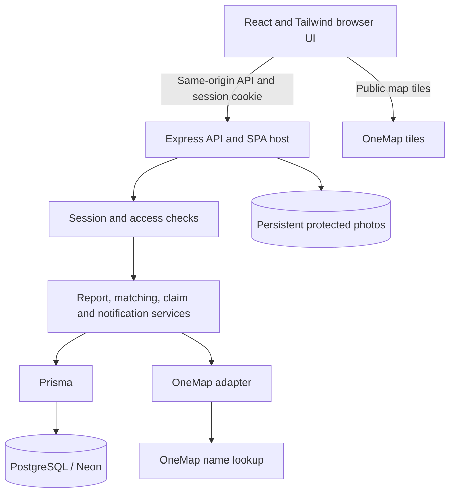
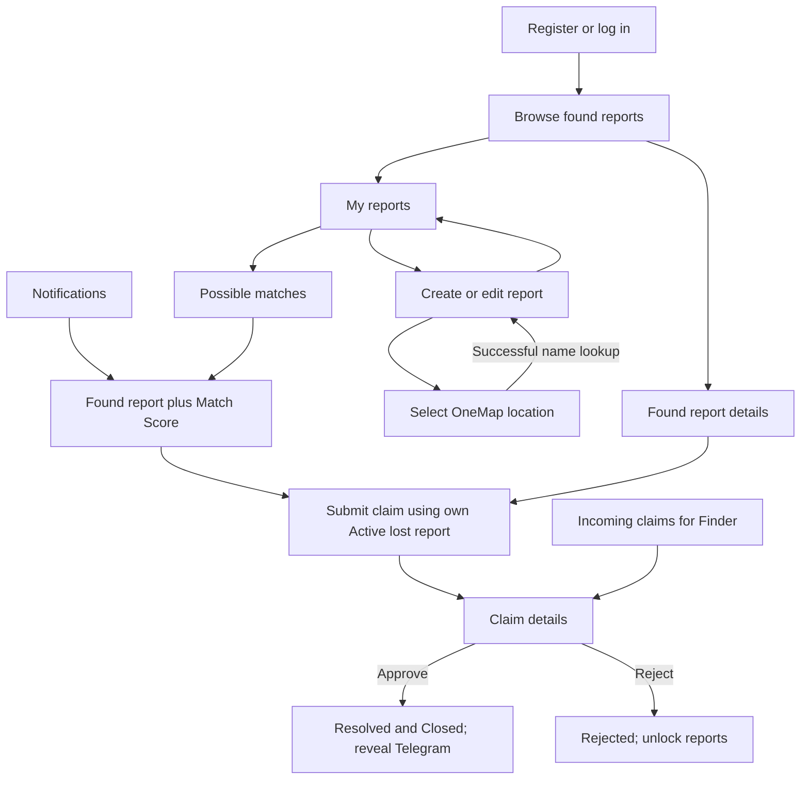

# Design alignment with the final application

The approved conceptual design is implemented using TypeScript modules and React pages. A conceptual control does not need to become a class with an identical name. The existing service modules provide those responsibilities.

| Conceptual element                                   | Existing code implementation                                                                                                  |
| ---------------------------------------------------- | ----------------------------------------------------------------------------------------------------------------------------- |
| Startup                                              | `backend/src/index.ts`, `app.ts`, `config/env.ts`; frontend `main.tsx`                                                        |
| Account/authentication control                       | `auth.service.ts`, auth/user routes, `AuthContext.tsx`                                                                        |
| Lost report control                                  | `lostReport.service.ts`, lost routes and report pages                                                                         |
| Found report/browse control                          | `foundReport.service.ts`, found routes and browse/report pages                                                                |
| Matching control                                     | `matching.service.ts` plus pure `domain/matching.ts`                                                                          |
| Claim control                                        | `claim.service.ts`, claim routes and claim pages                                                                              |
| Notification control                                 | `notification.service.ts`, notification routes and page                                                                       |
| Access control                                       | `requireAuth.ts`, `permissions.ts`, service ownership checks and DTO projections                                              |
| OneMap gateway                                       | `onemap.service.ts`, OneMap routes and `MapPicker.tsx`                                                                        |
| PersistentStore / List                               | Prisma model delegates / native typed arrays                                                                                  |
| Abstract ItemReport and notification specialisations | Concrete LostItemReport/FoundItemReport tables and typed Notification rows; conceptual inheritance mapped to concrete records |

## Persistence changes to reflect in the implementation diagram

Add `Session` (user 1 → 0..* sessions), `deletedAt: DateTime?` on both report types, and `eligible: Boolean` on MatchResult. Keep the existing entity relationships and multiplicities. Notification remains a typed row with either a MatchResult or OwnershipClaim foreign key. Login sessions are separate from domain claims/reports.

An aggregation diamond should only express a justified whole/part relationship; module dependencies on services or persistence are ordinary dependencies. Do not add aggregation just to join disconnected boxes. This application does not require an artificial List class.

## Runtime architecture

Deploy the API and frontend at one HTTPS origin. Database and photo storage persist across restarts. API credentials stay on the server.

## Dialogue changes to reflect

Pending claims show a lock on the associated reports. Edit/delete actions are unavailable until rejection; approval closes the workflow. Failed location lookups leave report submission disabled. Approved contacts are only visible to the two claim participants. Account and logout remain accessible from the existing navigation.

These notes document implemented code. The previously supplied diagram images and SRS PDF have not been silently edited; update final submission drawings to include these implementation details where the lab requires as-built documentation.
